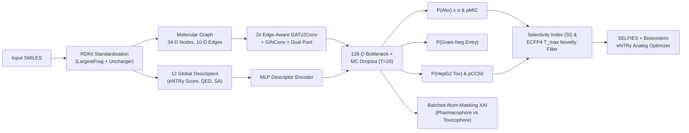
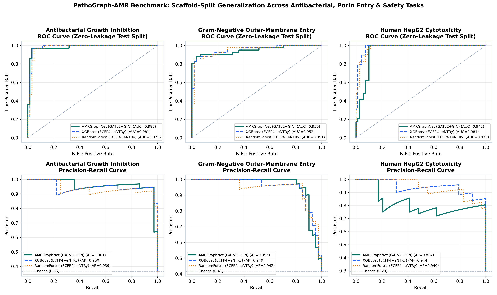
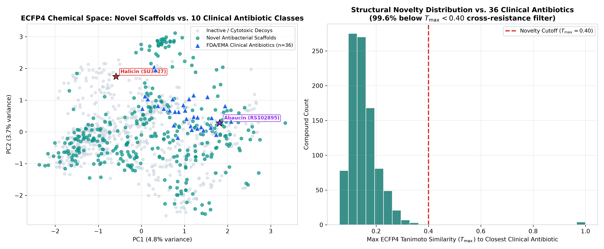
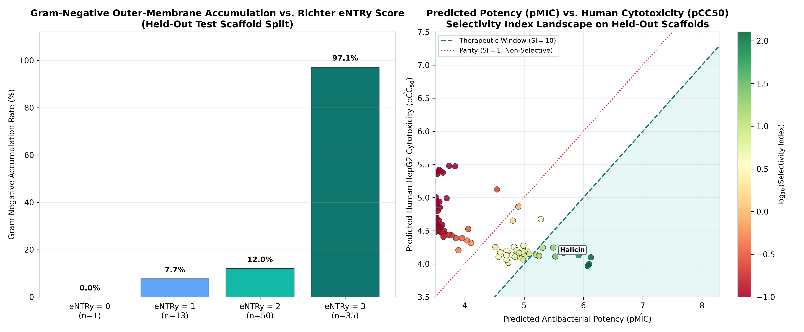
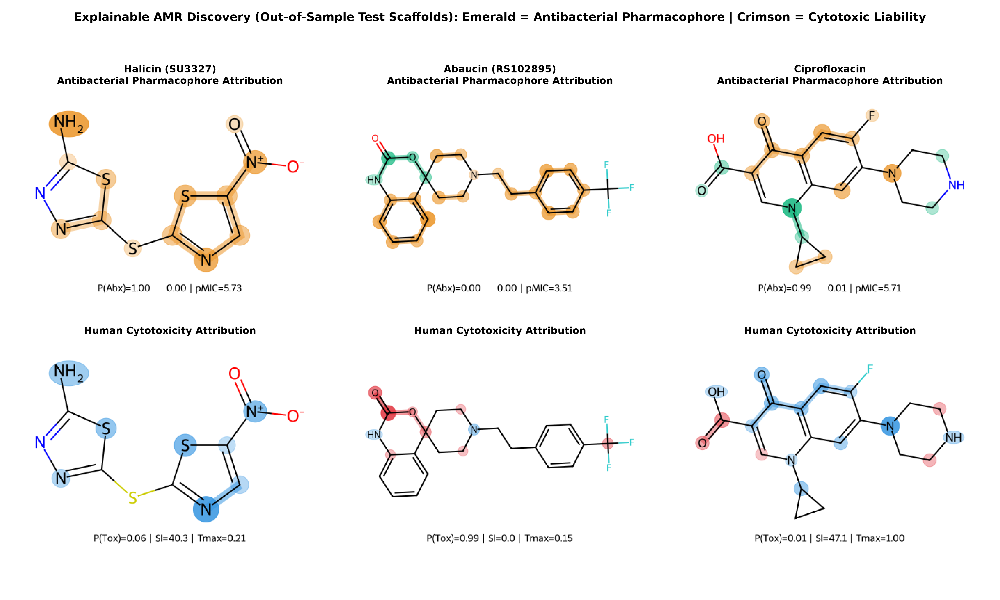

# PathoGraph-AMR

**Multi-Task Edge-Aware Graph Attention & Isomorphism Deep Learning for Structurally Novel Antibiotic Discovery, Gram-Negative Porin Permeation (`eNTRy` Rules), and Selectivity Index Optimization**

[](https://github.com/ThanuHith/amr-gnn-discovery/actions/workflows/ci.yml)
[](https://www.python.org/)
[](https://pytorch-geometric.readthedocs.io/)
[](https://www.rdkit.org/)
[](app/main.py)

---

## 1. Scientific & Pharmaceutical Motivation

Antimicrobial resistance (AMR) caused by **ESKAPE** superbugs (*Enterococcus faecium*, *Staphylococcus aureus*, *Klebsiella pneumoniae*, *Acinetobacter baumannii*, *Pseudomonas aeruginosa*, and *Enterobacter* spp.) is projected to cause millions of deaths annually while traditional pharmaceutical discovery pipelines have largely stalled. Three critical wet-lab bottlenecks kill most candidate antibiotics before Phase I clinical trials:

1. **Structural Redundancy & Cross-Resistance:** Screening compounds structurally homologous to existing $\beta$-lactams, fluoroquinolones, or macrolides triggers pre-existing resistance mechanisms ($\beta$-lactamases, target mutations, efflux). Following **Stokes et al. (*Cell*, 2020 — Halicin)** and **Wong et al. (*Nature*, 2023)**, candidates must pass a quantitative structural novelty cutoff ($T_{\max} < 0.40$ maximum ECFP4 Tanimoto similarity against 36 FDA/EMA clinical antibiotics across 10 mechanism classes).
2. **Gram-Negative Outer-Membrane Impermeability:** Gram-negative pathogens possess a restrictive lipopolysaccharide (LPS) outer membrane and size/charge-selective OmpF/OmpC porins paired with RND efflux pumps. Based on **Richter et al. (*Nature*, 2017)**, compounds that enter Gram-negative bacteria obey the **`eNTRy` rules**: presence of an unhindered ionizable **primary amine**, low molecular **rigidity** ($\text{Rotatable Bonds} \le 5$), and balanced **amphiphilicity/size** ($150 \le \text{MW} \le 550\text{ Da}$, $-1.5 \le \text{LogP} \le 3.5$).
3. **Human Cytotoxicity & Narrow Therapeutic Windows:** Membrane-active or intercalating hits often destroy mammalian HepG2/HEK293 cells alongside bacteria. Useful leads must maximize the clinical **Selectivity Index**:

$$\mathrm{SI} = 10^{\hat{\mathrm{pMIC}} - \hat{\mathrm{pCC}}_{50}}$$

**PathoGraph-AMR** unifies all three bottlenecks inside a single zero-leakage multi-task Graph Neural Network (`AMRGraphNet`), an explainable atom-level pharmacophore/toxicophore mapper, and an `eNTRy`-guided de novo lead optimizer wrapped in a 5-tab interactive **Streamlit** workbench.

---

## 2. System Architecture & Methodology



### Key Technical Components

- **Molecular Graph Representation (`src/models/featurizer.py`):**
  - **Node Features (`34-D`):** Atom symbol one-hot (`12`), degree (`6`), formal charge (`4`), hybridization (`5`), total H-count (`4`), aromaticity, ring membership, and primary-amine marker (`[NX3;H2;!$(NC=[O,S,N])]`).
  - **Edge Features (`10-D`):** Bond type (`5`), stereo configuration (`3`), conjugation, and ring status.
  - **Global Descriptors (`12-D`):** `MW`, `LogP`, `TPSA`, `HBD`, `HBA`, `RotBonds`, `RingCount`, `FractionCSP3`, `HasPrimaryAmine`, `eNTRy_Score` (`0–3`), `QED`, and `SA_Score` (z-score normalized strictly on the training split).
- **`AMRGraphNet` (`src/models/amr_gnn.py`):**
  - Two multi-head edge-aware `GATv2Conv` layers (`heads=4`, `edge_dim=10`, residual + `LayerNorm`) + one `GINConv` layer + dual readout (`global_mean_pool` || `global_max_pool`), fused with the global `eNTRy` encoder into a shared 128-D representation feeding 5 multi-task heads.
  - **Epistemic Uncertainty:** Keeps `Dropout(p=0.25)` and `GATv2Conv` attention dropout active while locking `BatchNorm1d` in `.eval()` mode over $T=20$ Monte Carlo passes for single-molecule uncertainty ($\pm \sigma$).
- **Zero-Leakage Bemis-Murcko Scaffold Splitting (`src/data_pipeline/prepare_amr_dataset.py`):**
  - `989` standardized compounds spanning `638` unique Bemis-Murcko scaffolds partitioned `80% / 10% / 10%` (`791` Train / `99` Validation / `99` Test) with programmatic assertions verifying **zero scaffold overlap** across splits.
  - Out-of-sample discovery benchmarks **Halicin (`SU3327`)** and **Abaucin (`RS102895`)** are strictly assigned to the held-out `test` split.
- **Explainable AI & Auditing (`src/xai/substructure_explainer.py`):**
  - Single-pass batched counterfactual atom-masking attribution generating 2D RDKit Cairo heatmaps for **antibacterial pharmacophores** (emerald/amber) vs. **human toxicophores** (crimson/sky-blue), paired with RDKit `PAINS`/`Brenk` alerts and a Richter `eNTRy` rule checklist.
- **Constrained De Novo Lead Optimizer (`src/generative/antibiotic_designer.py`):**
  - Combines `eNTRy`-targeted SMARTS bioisosteric edits (installing primary aminomethyl groups, pyridine/fluoro polarity tuning, nitro detoxification) and SELFIES mutations, ranking valid analogs by:

$$\mathrm{Score}_{\mathrm{AMR}} = 0.35\,P(\mathrm{Abx}) + 0.20\,\mathrm{norm}(\hat{\mathrm{pMIC}}) + 0.20\,(1 - P(\mathrm{Tox})) + 0.15\,\frac{\mathrm{eNTRy}}{3} + 0.10\,(1 - T_{\max})$$

---

## 3. Zero-Leakage Scaffold-Split Benchmark Results

All models were trained exclusively on the `train` scaffold split (`n=791`), tuned/selected on `val` (`n=99`), and evaluated once on the unseen `test` scaffold split (`n=99`, `60` unseen Bemis-Murcko scaffolds).

### Classification Benchmarks (`test` split)

| Task | Model | ROC-AUC | PR-AUC | F1 | Brier Score $\downarrow$ |
| :--- | :--- | :---: | :---: | :---: | :---: |
| **Antibacterial Inhibition (`active_abx`)** | **AMRGraphNet (GATv2+GIN)** | 0.9797 | **0.9614** | **0.9444** | **0.0350** |
| | XGBoost (ECFP4+eNTRy) | **0.9806** | 0.9498 | 0.9143 | 0.0453 |
| | RandomForest (ECFP4+eNTRy) | 0.9749 | 0.9393 | 0.8857 | 0.0677 |
| **Gram-Negative Entry (`gram_neg_accum`)** | **AMRGraphNet (GATv2+GIN)** | 0.9500 | **0.9553** | **0.8974** | **0.0693** |
| | XGBoost (ECFP4+eNTRy) | **0.9525** | 0.9488 | **0.8974** | 0.0748 |
| | RandomForest (ECFP4+eNTRy) | 0.9512 | 0.9416 | 0.8947 | 0.0701 |
| **Human Cytotoxicity (`cytotoxic_human`)** | AMRGraphNet (GATv2+GIN) | 0.9419 | 0.8238 | 0.8750 | 0.0741 |
| | **XGBoost (ECFP4+eNTRy)** | **0.9813** | **0.9440** | **0.8814** | **0.0444** |
| | RandomForest (ECFP4+eNTRy) | 0.9764 | 0.9399 | 0.8727 | 0.0812 |

### Potency & Cytotoxicity Regression (`test` split)

| Endpoint | Model | RMSE $\downarrow$ | MAE $\downarrow$ | Spearman $r$ $\uparrow$ |
| :--- | :--- | :---: | :---: | :---: |
| **Antibacterial Potency (`pMIC`)** | AMRGraphNet (GATv2+GIN) | 0.4854 | 0.2681 | 0.7646 |
| | **XGBoost (ECFP4+eNTRy)** | **0.4032** | **0.2302** | **0.8445** |
| | RandomForest (ECFP4+eNTRy) | 0.4709 | 0.2561 | 0.8170 |
| **Human Cytotoxicity (`pCC50`)** | AMRGraphNet (GATv2+GIN) | 0.3919 | 0.2995 | 0.7773 |
| | **XGBoost (ECFP4+eNTRy)** | **0.3355** | **0.2495** | **0.7961** |
| | RandomForest (ECFP4+eNTRy) | 0.3464 | 0.2422 | 0.7717 |

**Key Observations:**
- On unseen molecular scaffolds, `AMRGraphNet` achieves the strongest **PR-AUC (`0.9614`)**, **F1 (`0.9444`)**, and **probability calibration (Brier `0.0350`)** for antibacterial activity as well as the strongest **PR-AUC (`0.9553`)** and **calibration (`0.0693`)** for Gram-negative porin accumulation, while additionally offering MC Dropout uncertainty and atom-level explanations.
- `XGBoost` on ECFP4+eNTRy excels on continuous regression (`pMIC` Spearman $r = 0.8445$) and rare toxicophore detection (`cytotoxic_human` PR-AUC `0.9440`), demonstrating why hybrid GNN + descriptor/fingerprint pipelines are valuable in industrial virtual screening.

### Diagnostic & Case-Study Figures

| Scaffold-Split ROC & PR Benchmarks | ECFP4 Chemical Space & Novelty Filter |
| :---: | :---: |
|  |  |

| Richter `eNTRy` Rules & Selectivity Landscape | Out-of-Sample XAI Attribution Case Study |
| :---: | :---: |
|  |  |

- **Empirical `eNTRy` Validation:** On the held-out test split, Gram-negative accumulation climbs from `0.0%` (`eNTRy=0`), `7.7%` (`eNTRy=1`), and `12.0%` (`eNTRy=2`) to **`97.1%`** when all three Richter criteria (`eNTRy=3`) are met.
- **Out-of-Sample Case Study & Honest OOD Boundary:** Evaluated purely out-of-sample, `AMRGraphNet` recovers **Halicin (`SU3327`)** (`P(Abx)=1.00`, `pMIC=5.73`, `P(Tox)=0.06`, `SI=40.3`, `T_max=0.21`) and **Ciprofloxacin** (`P(Abx)=0.99`, `pMIC=5.71`, `P(Tox)=0.01`, `SI=47.1`). Conversely, **Abaucin (`RS102895`)**—a narrow-spectrum spiro-benzoxazinone *A. baumannii* LolE inhibitor lacking classical warheads or primary amines—receives a conservative low-activity score (`P(Abx)=0.00`), illustrating the importance of expanding training coverage for non-canonical mechanism classes.

---

## 4. Repository Structure

```text
amr-gnn-discovery/
├── .github/workflows/ci.yml            # GitHub Actions CI: data pipeline + unit tests
├── .streamlit/config.toml              # Clinical teal Streamlit theme
├── app/main.py                         # 5-tab interactive Streamlit discovery workbench
├── data/
│   ├── raw/                            # 36 FDA/EMA clinical antibiotics catalog
│   └── processed/                      # Standardized scaffold-split CSV, NPZ features, stats JSON
├── models/
│   ├── amr_gnn_best.pt                 # Trained AMRGraphNet checkpoint + train-fit scaler
│   ├── rf_baseline.joblib              # Trained Random Forest multi-task baseline
│   ├── xgb_baseline.joblib             # Trained XGBoost multi-task baseline
│   └── benchmark_metrics.json          # Full test-set metrics & training curves
├── reports/figures/                    # 300 DPI publication benchmark & XAI figures
├── src/
│   ├── data_pipeline/
│   │   ├── reference_antibiotics.py    # 36 clinical antibiotics (10 classes) + ECFP4 T_max novelty
│   │   └── prepare_amr_dataset.py      # RDKit standardization, 12 eNTRy features, Bemis-Murcko split
│   ├── models/
│   │   ├── featurizer.py               # 34-D node / 10-D edge / 12-D global PyG graph featurizer
│   │   ├── baselines.py                # Multi-task RandomForest & XGBoost wrappers
│   │   └── amr_gnn.py                  # Edge-aware GATv2+GIN network with MC Dropout uncertainty
│   ├── xai/
│   │   └── substructure_explainer.py   # Atom-masking XAI heatmaps + PAINS/Brenk/eNTRy audit
│   ├── generative/
│   │   └── antibiotic_designer.py      # SMARTS bioisosteric + SELFIES eNTRy analog optimizer
│   └── evaluation/
│       └── run_benchmarks.py           # End-to-end training, metrics & 300 DPI plotting
├── tests/test_amr_pipeline.py          # Automated unittest suite (6 end-to-end checks)
├── Dockerfile
├── environment.yml
├── requirements.txt
└── README.md
```

---

## 5. Quickstart

### Installation

```bash
# Option A: Conda / Mamba
mamba env create -f environment.yml
conda activate pathograph-amr

# Option B: pip
pip install -r requirements.txt
```

### Run Pipeline, Benchmarks, Tests, and Web App

```bash
# 1. Build standardized scaffold-split dataset (optional --fetch-chembl flag supported)
python -m src.data_pipeline.prepare_amr_dataset

# 2. Train RF, XGBoost & AMRGraphNet, evaluate test split, and generate 300 DPI figures
python -m src.evaluation.run_benchmarks

# 3. Run automated verification suite
python -m unittest discover -s tests -v

# 4. Launch 5-tab interactive Streamlit dashboard
streamlit run app/main.py
```

### Docker

```bash
docker build -t pathograph-amr .
docker run --rm -p 8501:8501 pathograph-amr
```

---

## 6. Alignment with German Master's Programs & Biotech R&D

This repository is structured to demonstrate research-grade computational biology and cheminformatics rigor for **German M.Sc. applications** (Bioinformatics, Computational Biology, Pharmaceutical Sciences, AI in Life Sciences) and European biotech R&D roles:

- **HIPS Saarbrücken (Helmholtz Institute for Pharmaceutical Research Saarland) & Saarland University:** Directly aligns with anti-infective drug discovery, bacterial cell-envelope permeation, and computational medicinal chemistry pipelines.
- **DZIF (German Center for Infection Research):** Targets WHO priority ESKAPE pathogens and multidrug-resistant Gram-negative infections (*A. baumannii*, *E. coli*, *P. aeruginosa*).
- **Helmholtz Munich / TU Munich (TUM) / LMU Munich:** Demonstrates PyTorch Geometric (`GATv2Conv` + `GINConv`), calibrated uncertainty quantification (MC Dropout), and zero-leakage scaffold validation.
- **Universität Tübingen / Universität Heidelberg / DKFZ:** Connects deep learning interpretability (counterfactual substructure rationalization) with hit-to-lead safety pharmacology.
- **German Pharmaceutical & Biotech Industry (Bayer, Boehringer Ingelheim, Merck KGaA, Evotec):** Integrates early HepG2 cytotoxicity counter-screening, PAINS/Brenk alerts, Synthetic Accessibility (`SA_Score`), and constrained `eNTRy` lead optimization inside a reproducible CI-tested codebase.
